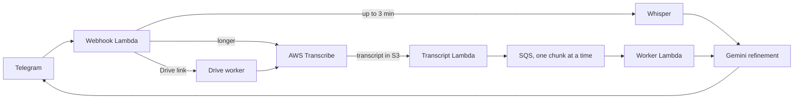

# Transcribe Bot

Telegram bot that turns voice messages, audio files and public Google Drive links into
clean, readable text. Short clips are transcribed with OpenAI Whisper, long ones with AWS
Transcribe, and every transcript is polished by Google Gemini before it goes back to the chat.

It runs serverless on AWS Lambda, with a monthly quota per chat.

## How It Works



1. **Short audio** (up to 3 minutes, at most 20 MB, ogg, mp3, wav or flac) is transcribed
   directly with Whisper inside the webhook Lambda. If Whisper fails, the bot falls back to AWS Transcribe.
2. **Long audio** and other formats (m4a, mp4) go to AWS Transcribe, which also detects the language.
   When the transcript lands in S3, an EventBridge rule triggers the transcript Lambda.
3. **Google Drive links** to public audio files (up to 70 MB) are downloaded by a separate worker
   Lambda, uploaded to S3 and sent to AWS Transcribe.
4. **Long transcripts are split into chunks** of about 3,000 characters on sentence boundaries.
   Chunks go through SQS one at a time. The worker refines a chunk with Gemini, sends it to the chat
   as `Part i/n`, and only then queues the next one, so parts always arrive in order.
5. Replies longer than Telegram allows are split into several messages.

Decoupling through SQS and EventBridge keeps the webhook fast and lets each stage retry on its own.

## Refinement with Gemini

Gemini removes fillers and false starts, fixes punctuation and splits the text into paragraphs, while
keeping the speaker's tone, word choice and order. It returns structured output
(`refined_text`, `language`, `problem_reason`) validated with a Pydantic schema.

- The prompt treats the transcript strictly as content, never as instructions.
- If Gemini fails, blocks the text or returns something unusable, the user gets the **unrefined transcript**
  together with a short reason, so a refinement problem never loses the result.

## Commands, Limits and Quota

| Command | Action |
|---|---|
| `/start` | Short usage help |
| `/limit` | Used and remaining quota for the current month |
| `/privacy` | Privacy policy link and notice about AI processing |
| `/contact` | How to reach the developer |

- Telegram files are limited to 20 MB (the Bot API download limit), Drive files to 70 MB.
- Every chat has a monthly quota of audio bytes (30 MB by default, `MONTHLY_QUOTA_BYTES`). A file that would
  exceed it is rejected with a message that shows usage and how to ask for more.
- Usage is counted in DynamoDB. `./usage.sh [YYYY-MM]` prints a per-user report for a month.

## Configuration

Environment variables:

| Variable | Purpose |
|---|---|
| `S3_BUCKET_NAME` | Bucket for audio files and transcript JSONs |
| `SQS_QUEUE_URL`, `SQS_DRIVE_QUEUE_URL` | Chunk queue and Drive download queue |
| `USAGE_TABLE_NAME` | Quota and usage table |
| `MONTHLY_QUOTA_BYTES`, `MONTHLY_QUOTA_LABEL` | Quota size and its display label |
| `GEMINI_MODEL` | Refinement model (default `gemini-2.5-flash`) |
| `SECRET_NAME` | AWS Secrets Manager secret (default `transcribe-bot-secret`) |
| `PRIVACY_URL`, `CONTACT_URL` | Links shown in `/start`, `/privacy`, `/contact` and quota messages. Optional, the texts work without them. |

Secrets, read at runtime from one Secrets Manager secret (JSON): `TELEGRAM_BOT_TOKEN`, `WEBHOOK_SECRET`,
`GEMINI_API_KEY`, `OPENAI_API_KEY`. The job and chunk table names are defined in `repository/`.

## Privacy

- Logs contain ids, sizes and character counts, never message text, transcripts or file names.
- The code stores the Telegram chat id and username for quota accounting, plus job and chunk records
  (including transcript text) with a 60-day TTL. Audio and transcript files in S3 are meant to expire
  through a bucket lifecycle rule.
- Users are told that AI services process what they send and are asked not to share confidential content.

## Development

```bash
pip install -r requirements.txt pytest
pytest
```

The tests need no AWS access and no real tokens: `tests/conftest.py` sets a dummy region, credentials and
test URLs, and the service modules are replaced with fakes where they would call out.

To run the API locally:

```bash
pip install uvicorn
uvicorn app:app --reload
```

Expose it (for example with ngrok) and register the Telegram webhook with the `WEBHOOK_SECRET` as secret token.

## Deployment

`./deploy.sh [main|worker|drive|transcript]` builds Linux wheels, zips the code, uploads it to S3 and
updates one Lambda. Without an argument it deploys all four:

| Target | Lambda | Handler |
|---|---|---|
| `main` | Telegram webhook | `app.py` |
| `transcript` | Reacts to finished AWS Transcribe jobs | `transcript_event_entry.py` |
| `worker` | Refines chunks from SQS | `worker.py` |
| `drive` | Downloads Drive files | `drive_worker.py` |

The script expects an AWS CLI profile named `personal`; set `S3_BUCKET` to choose the artifact bucket.

## Project Layout

```text
app.py                         FastAPI webhook (Mangum on Lambda)
transcript_event_entry.py      Lambda: finished AWS Transcribe jobs
worker.py                      Lambda: chunk refinement and delivery
drive_worker.py                Lambda: Google Drive downloads
services/                      Telegram, Whisper, AWS Transcribe, Gemini, quota, S3, SQS, DynamoDB
repository/                    DynamoDB access
utils/                         audio parsing, chunking, quota formatting, texts
usage_report.py                monthly usage report (see usage.sh)
tests/
```
